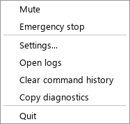
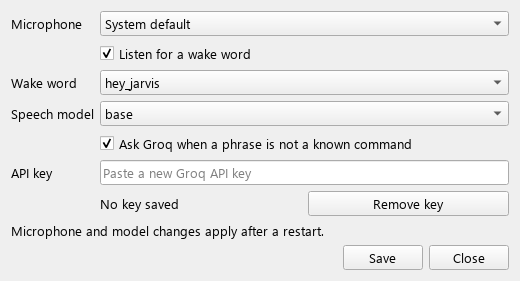

# EVEE: Voice PC Agent

Offline-first voice control for Windows 11. Say "wake up ev", then just talk: "next tab",
"scroll down", "copy that". Say "sleep ev" when you're done.

Wake word, speech recognition and command matching all run **locally on your CPU**. A cloud
model (Qwen on Groq) is asked **only** when a phrase matches no known command, and even
then it can only pick a command from a fixed list. A local policy engine approves or
refuses that pick.


| Tray menu | Settings |
|---|---|
|  |  |

## What it does

55 everyday commands (tabs, pages, editing, media, volume, windows, the desktop, zoom), and
plugins add more. The
full list is in the [command reference](docs/command-reference.md). Try the pipeline
without a microphone:

```text
> voice-agent --dry-run
Voice PC Agent — dry run. 56 commands loaded.
Type a phrase, or 'quit'.

> next tab
  resolved:  browser.next_tab (alias, confidence 1.00)
  policy:    allow (ok)
  simulated: ctrl+tab
  result:    success — Switch to the next browser tab
> skip forward 30 seconds
  resolved:  media.seek_forward (alias, confidence 1.00, 30s)
  policy:    allow (ok)
  simulated: right x6
  result:    success — Skip forward in the current media
> close this window
  resolved:  window.close (alias, confidence 1.00)
  policy:    confirm (confirmation_required)
  Confirm: Close the focused window? [y/N] (10s) (timed out)
  result:    denied — Cancelled — not confirmed.
> delete all my files
  resolved:  nothing — I didn't recognise that command.
  policy:    deny (no_action)
  result:    denied — No action taken.
```

## Design in one line

**The model proposes; the local policy engine disposes.**

The cloud model returns strict JSON naming one intent from a list generated from the
command registry. It never returns code, key sequences, shell commands or file paths.
Anything outside the registry is refused; there is no best-effort path.

```text
mic ─▶ wake word ─▶ VAD ─▶ faster-whisper ─▶ alias matcher ──match──▶ policy ─▶ action
      (local)     (local)     (local)            (local)    │          (local)
                                                            └─miss──▶ Groq/Qwen ─┘
```

A known command goes from transcript to keypress in 1.6 ms (p95). See
[architecture](docs/architecture.md).

## Privacy

| | |
|---|---|
| Audio | Never leaves your PC, never written to disk; dropped at the source while muted |
| Transcripts | Sent to Groq **only** when no local command matches, with the cloud on and your own key; cut to 500 characters |
| Saved transcripts | Off by default |
| API key | Windows Credential Manager or the environment; never in code, config, logs or builds |
| Audit log | Local file; what you said is kept only as a keyed hash, unless you set both `privacy.store_transcripts: true` and `privacy.redact_sensitive_logs: false` |
| Telemetry | None |

Details: [privacy](docs/privacy.md) and [security model](docs/security-model.md).

## Requirements

Windows 11, Python 3.12, a microphone, about 1.5 GB of disk. No GPU. A Groq API key is
optional; without one, every listed command still works.

## Quick start

```powershell
py -3.12 -m venv .venv ; .\.venv\Scripts\Activate.ps1
pip install -e ".[voice,cloud,windows,ui]"
voice-agent --self-test
voice-agent --tray
```

Full guide: [setup on Windows](docs/setup-windows.md). Problems:
[troubleshooting](docs/troubleshooting.md).

## Layout

| Path | Contents |
|---|---|
| `src/voice_agent/` | The application (package map in `CLAUDE.md` §6) |
| `config/` | `default.yaml` settings and the built-in `commands.yaml`; your overrides go in `user.yaml` |
| `plugins/` | Browser, media and window commands, plus the `zoom` example |
| `docs/` | Setup, commands, privacy, security, architecture, plugins, ADRs |
| `specs/` | JSON Schemas for the intent and plugin contracts |
| `scripts/` | Groq check, benchmarks, corpus scoring, Windows build |
| `CLAUDE.md`, `docs/plan/` | Engineering contract and the task plan |

## Contributing

See [CONTRIBUTING.md](CONTRIBUTING.md). New commands come as plugins
([guide](docs/plugin-development.md)), never as direct calls into an action module. Run
`scripts/verify.ps1` before a pull request.

MIT licensed.
