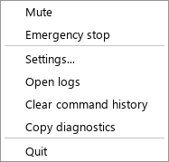
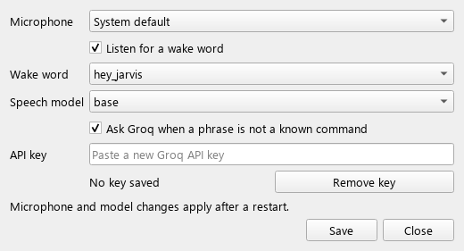

# Windows setup

## Requirements

- Windows 11. Windows 10 21H2 or later probably works but is untested.
- **Python 3.12** exactly. 3.13 lacks reliable wheels for some audio and ML packages.
- A microphone, with Windows Settings → Privacy & security → Microphone → "Let desktop apps
  access your microphone" turned on.
- About 1.5 GB of disk for the packages and models. No GPU needed.
- Optional: a [Groq API key](https://console.groq.com/keys), for phrases that aren't
  listed commands.

## Install from source

```powershell
py -3.12 -m venv .venv
.\.venv\Scripts\Activate.ps1
python -m pip install --upgrade pip
pip install -e ".[voice,cloud,windows,ui]"     # add ,dev to run the tests
voice-agent --self-test
```

If an install step fails, add the extras one at a time; `voice` pulls the largest wheels.
The self-test should end with `self-test passed`. It needs no microphone, model or key.

## First run

```powershell
voice-agent --tray
```

A coloured dot appears in the notification area and an indicator pill in the
bottom-right corner. Click the pill to give a command without saying the wake word (or to
listen again when muted), right-click it for the menu, and drag it anywhere; it remembers
where you put it. The first start downloads the speech model (about 150 MB for `base.en`) and the
wake-word models. That happens once; after that the agent starts offline.

Say **"wake up ev"**, or click the pill: it turns green, and from then on every sentence is a
command, such as "next tab" or "scroll down". Say **"sleep ev"**, or click the pill again,
to stop. The
[command reference](command-reference.md) lists them all.



## Ways to run it

| Command | What it does |
|---|---|
| `voice-agent --tray` | The app: tray icon, indicator, Yes/No dialogs, notifications |
| `voice-agent` | Live voice in a console window; Yes/No questions are asked in the console; Ctrl+C quits |
| `voice-agent --no-llm` | Either of the above with the cloud switched off for this run |
| `voice-agent --dry-run` | Type phrases instead of speaking; shows what would happen and presses nothing |
| `voice-agent --self-test` | Checks the install offline, then exits |
| `voice-agent --version` | Prints the version |

## Settings

Tray → **Settings...** covers the microphone, wake word, speech model, the cloud switch and
the API key:



A key saved here goes to Windows Credential Manager, not a file. For development you can
instead set `GROQ_API_KEY` in the environment, or in a `.env` file copied from
`.env.example`. Never commit `.env`.

Everything else lives in YAML:
- `config/default.yaml`: the defaults. Don't edit it.
- `config/user.yaml`: your overrides, in the same layout. The Settings window writes here
  too. The packaged app uses `%LOCALAPPDATA%\voice-pc-agent\user.yaml` instead, so a new
  version keeps your settings. A list such as `plugins.enabled` replaces the default list; it isn't merged.
- Environment variables override both: `VOICE_AGENT__SECTION__KEY`, for example
  `VOICE_AGENT__LLM__ENABLED=false`.

The emergency stop is **Ctrl+Alt+Space** by default. If another program already uses it,
the agent falls back to **Ctrl+Alt+Backspace** and tells you so. To choose your own, set
`app.emergency_stop_hotkey` in your `user.yaml` (see
[troubleshooting](troubleshooting.md#the-emergency-stop-hotkey-doesnt-work)).

## Building the Windows app

```powershell
pip install -e ".[dev,voice,cloud,windows,ui,build]"
powershell -ExecutionPolicy Bypass -File scripts\build_windows.ps1
```

This produces `dist\VoicePCAgent\VoicePCAgent.exe` (about 450 MB with its folder), stamped
with the package version. The
script runs the tests first, refuses to build if the sources contain anything key-shaped,
and fails the build if a key-shaped string, a `.env` or a `user.yaml` ended up inside. It then runs the exe's self-test under a fresh, empty user
profile with no key. Models are not bundled; they download on first run.

Notes for the built app:
- It opens the tray directly; it has no console.
- Its settings live in `%LOCALAPPDATA%\voice-pc-agent\user.yaml`, outside the app folder,
  so unzipping a new version keeps them.
- The first start downloads the speech and wake-word models, so it needs the internet once
  and takes a minute or two. The wake-word models are saved inside the app folder, so they
  download again after you replace it with a new version.
- Only one copy runs at a time; starting it again just says it's already running.
- It is unsigned, so SmartScreen warns on first launch. Check the SHA-256 published with
  the release before running it.

## Platform quirks

- **Admin windows** ignore input from a program that isn't running as administrator. See
  [troubleshooting](troubleshooting.md#commands-dont-work-in-one-particular-window).
- **Mixed-DPI multi-monitor setups** are why this project uses keyboard shortcuts and
  window messages, never mouse clicks at coordinates.
- **Exclusive-mode audio apps** (some DAWs) can seize the microphone. Choose a different
  microphone in Settings while they run.
